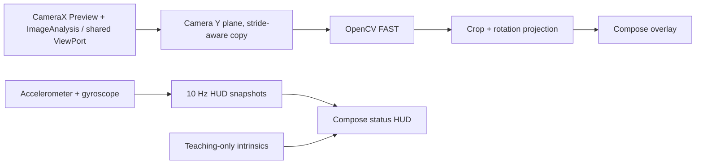

# Mobile SLAM

Android teaching app for making monocular visual-SLAM pipeline stages visible to students. The startup screen is a mode menu with a reserved logo slot; the **Tryb na żywo** route displays CameraX preview, OpenCV FAST detections, pyramidal Lucas–Kanade (KLT) correspondences, available IMU samples and teaching-only camera intrinsics.

## Assumptions

- This delivery is milestone 1; the menu shows tracking, initialization, map, recording/replay, metrics and optional ARCore as **disabled** future routes; **Kalibracja kamery** now opens the photo-based measurement screen. The Settings screen edits and persists FAST and IMU HUD parameters (#22). A preliminary read-only hardware overview is available; complete diagnostics and export remain #23.
- Live use requires a rear camera and runtime camera permission. Missing accelerometer or gyroscope hardware does not prevent camera analysis.
- The displayed intrinsics are a teaching estimate for a nominal 640×480 image, not measured device calibration. CameraX can select another supported resolution.
- FAST detections seed KLT feature tracks; validated forward/backward optical flow carries stable IDs and track ages across frames. These are **2D image correspondences**, not triangulated map points, geometric inliers or camera pose.
- Camera and sensor timestamps are exposed in nanoseconds as reported by Android. Camera clock source and sensor time alignment must be validated per device before fusion.

## Build and run

1. Install Android Studio, JDK 17, Android SDK platform 35, and build tools 35.0.0.
2. Open the project in Android Studio, or run `./gradlew :app:assembleDebug`.
3. Install the debug APK on a physical Android 8.0+ device with a rear camera, or an emulator with a configured camera.
4. The **menu launches without camera permission**. Select **Tryb na żywo** and grant permission only then. The live screen shows FAST keypoints and available sensor values; use **Powrót do menu** or system Back to leave the camera.
5. **Ustawienia** edits FAST threshold (1–255, default 20) and IMU HUD update interval (100–1000 ms, default 100). Settings persist across restarts and apply on the next **Tryb na żywo** entry. **Przywróć domyślne** resets both fields. Future controls are disabled.
6. **Parametry sprzętowe i diagnostyka** shows a read-only, source-labelled hardware inventory: Android/build/API, CPU/RAM/storage/display/battery/thermal information, reported Camera2 properties (including timestamp source), sensor metadata and previously observed CameraX ImageAnalysis geometry and cadence. It does not request CAMERA permission or activate IMU on entry.
7. **Uruchom pomiar IMU** explicitly subscribes to available accelerometer/gyro events, independently from the 10 Hz teaching HUD. Stop the test to see observed callback counts, median Hz, jitter and gaps. The listener stops automatically on lifecycle stop/screen exit.
8. **Uruchom test kamery (tryb na żywo)** opens the existing camera preview and requests camera permission there only. After returning to the diagnostic screen, observed resolution, crop/rotation, Y strides, camera timestamps and processing time can be inspected. **Eksportuj JSON** writes a locally selected schema-v1 report with units, source labels, missing-data reasons and an untested hardware acceptance checklist. No images, recordings or unique device IDs are exported.
9. **O aplikacji** shows version/license, and **Zamknij aplikację** finishes the Activity.

Run local JVM tests with `./gradlew :app:testDebugUnitTest`.
Run Android lint with `./gradlew :app:lintDebug`.
Run Kotlin formatting checks with `./gradlew :app:ktlintCheck`.
Compile Compose Android UI tests (without an emulator) with `./gradlew :app:assembleDebugAndroidTest`. The instrumentation tests require a device/emulator to execute; compilation **does not** mean they have passed on hardware.
The `Android CI` workflow runs all four tasks on pull requests and pushes to `main` and `fix/**`. It uploads Gradle test/lint reports and a downloadable `mobile-slam-debug-apk` artifact. From a successful workflow run, download and extract the APK, then install with `adb install -r app-debug.apk` after enabling USB debugging on the test device.

## Architecture

The navigation shell uses a typed `AppDestination` registry and blocks destinations marked as unavailable. Preferences DataStore maintains a versioned, validated immutable Settings snapshot, read once into the app-level state. New values apply to freshly created FAST and IMU HUD objects when the Live screen is entered, never by mutating active OpenCV processing. The main menu does not acquire sensors. Live camera/IMU resources exist only while **Tryb na żywo** is composed; returning to the menu disposes them. No external navigation framework was introduced for this small first milestone.

Camera analysis runs on a dedicated single-thread executor and publishes immutable feature snapshots to the main thread. With the M2 frame contracts, a per-session ordering gate rejects invalid, duplicate and decreasing CameraX timestamps before processing, while a coalescing main-thread dispatcher keeps **at most one pending UI snapshot**. CameraX `KEEP_ONLY_LATEST` remains the bounded acquisition policy. Changes in ImageProxy dimensions, crop or rotation start a new geometry segment while frame IDs remain increasing. The analyzer is retired on its serial executor after camera unbind. The camera preview and image-analysis use cases share a CameraX `UseCaseGroup` / `ViewPort`; the overlay maps raw FAST coordinates through the image crop and rotation into `PreviewView` coordinates. A compatible TextureView ensures Compose draws above the camera image.

Camera use cases are bound to the lifecycle and unbound individually when the screen is disposed. When a Compose `AndroidView` is recreated after navigating through document picker/calibration, `PreviewView.viewPort` may initially be null despite known layout dimensions. The live camera binding now retries that pending viewport at most 12 times (250 ms spacing), also retries when the view attaches or the host resumes, cancels retries on disposal, and shows **waiting for the first CameraX frame** instead of a misleading green running status before any frames arrive. The retry must be tested on a physical phone; it does not prove all CameraX lifecycle edge cases are fixed. IMU listeners start at `ON_START` and unregister at `ON_STOP`. The sensors run in Android's `SENSOR_DELAY_GAME` mode; HUD snapshots are throttled to approximately 10 Hz to avoid unnecessary recompositions. Accelerometer and gyroscope timestamps are retained separately. This HUD path is not a synchronized, full-rate visual-inertial sensor-fusion feed.

First on-device KLT screen-recording observations and remaining physical checks are documented in [docs/device-tests/sm-s938b-2026-11-05-klt.md](docs/device-tests/sm-s938b-2026-11-05-klt.md). A new Live subtitle layout fix avoids clipping on the recorded portrait screen; retest on the device is still required.

## Temporal FAST-to-KLT tracking (M2)

The analyzer owns the current grayscale Mat and a single retained previous grayscale clone. OpenCV `Video.calcOpticalFlowPyrLK` estimates correspondences in both directions; points are accepted only when both status flags succeed, coordinates are finite and in the ImageProxy crop, and the forward–backward residual is below the configured threshold. A spatially distributed, bounded pool replenishes verified tracks from FAST detections when fewer than the configured minimum remain.

The overlay uses **cyan** for freshly detected seeds and **green** for points tracked from the preceding frame, with short image-space displacement segments. It reports separate new/tracked/rejected counts. Stable track IDs and ages are reset on loss, image geometry/rotation/crop change or a timestamp gap longer than 250 ms (IDs are not reused within an analyzer session). KLT is not visual odometry or SLAM initialization. Monocular scale, calibration and camera–IMU temporal alignment remain unresolved.

KLT thresholds are validated in `frontend.Settings` with defaults: 240 maximum tracks; replenishment under 90; 21-pixel LK window; pyramid level 3; 1.5 px forward/backward error limit; 9 px minimum separation; 8×6 spatial cells. The KLT configuration is currently fixed in the UI; only previously supported FAST threshold and IMU HUD settings are persisted.

## Chessboard calibration (M2 / issue #9)

The **Kalibracja kamery** menu entry opens a photo-based OpenCV calibration workflow. It does not need live CameraX permission. Use a flat printed chessboard with a **measured square pitch** (default input 20 mm). Automatic pattern detection is enabled by default and supports **4–16 inner corners along each axis** (for example, **8×11 squares = 7×10 inner corners**). Detection runs only until the first usable pattern observation; remaining photographs use the same detected geometry. A manual override remains available for difficult views. Photograph it at 12–25 different positions, scales and tilts using the **same physical lens and fixed zoom/focus**. Select 8–40 JPEG/PNG images via Android's document picker. Use photos with consistent pixel geometry. EXIF 90°/180°/270° photo rotations are normalized before corner detection, while mirrored EXIF images are explicitly rejected. The image decoder reduces large photos for bounded processing; the resulting profile records the decoded image resolution.

OpenCV `findChessboardCorners` + `cornerSubPix` extracts image observations, rejecting insufficient board coverage, duplicate views and inconsistent image dimensions. Pattern discovery first tries common sizes, then bounded candidates; a reduced copy speeds up searching while final corner coordinates are measured in the decoded full-resolution image. The UI reports the detected inner-corner count and corresponding square count. In manual mode enter **inner corners**, not squares (inner corners = squares − 1). `calibrateCamera` estimates the pinhole intrinsics and five Brown–Conrady coefficients. At least eight diverse detections and RMS reprojection error at most **1.5 px** are required; failed attempts yield no profile. Input photos stay local and are not uploaded. Image Mats and bitmaps are released between photos.

A successful profile reports physical-camera ID **entered by the operator**, the full 3×3 pinhole camera matrix K in pixels, all five Brown–Conrady distortion coefficients, RMS, resolution and provenance. The same validated profile is persisted in a dedicated local Preferences DataStore and displayed under **Ustawienia → Kalibracja kamery**, including after an app restart. Successfully imported JSON profiles are also stored locally. **Importuj/Eksportuj profil JSON** uses Android's Storage Access Framework; photos are never stored by the calibration feature. A failure reports counts by rejection reason (decode, mirrored EXIF, inconsistent resolution, missing corners, coverage or duplicate view). The general settings reset does not delete the measured calibration.

**Scientific limitation:** the user-entered camera ID and image RMS do not independently verify that selected photographs came from the same optical pipeline as CameraX ImageAnalysis (sensor crop, stabilization, zoom, focusing and orientation can differ). EXIF rotation normalization makes profile K relative to **oriented, decoded image pixels**, not automatically to unrotated Camera2 sensor coordinates. A photo-derived profile must be validated against actual CameraX frames and independent chessboard reprojection measurements before use for essential-matrix triangulation or PnP. There is **no automatic activation** of the profile in Live/KLT, and monocular metric scale is still unknown. Issue #9 physical-device acceptance remains open.

## Read-only measured calibration compatibility in Live (issue #9)

The Live screen reads the last locally saved measured camera profile, if one exists. It compares the recorded physical Camera2 ID against the actual bound camera ID and the profile's full-frame dimensions/crop against the **observed** `ImageProxy` buffer (not the requested CameraX resolution). A dedicated fail-closed validator reports: no profile, unknown camera ID, different physical camera, no valid frame yet, incompatible geometry, or a geometry-compatible **unverified** candidate. For compatible frames only, it computes a transformed `K` for read-only display, including the observed crop offset. Otherwise the HUD explicitly labels its fixed 640×480 intrinsic parameters as DEMO. The measured candidate is **not** applied to FAST/KLT, undistortion, essential-matrix/PnP, camera fusion, or exported as an accepted hardware calibration. Device-optics equivalence, focus/zoom, EXIF-to-sensor mapping, stabilization and actual crop must still be verified before enabling quantitative geometry.

The validator is covered by deterministic JVM tests for missing/wrong camera IDs, waiting for frames, incompatible aspect/crop and uniform scaling. Physical-device acceptance remains open in #9 and #4.

**Portrait photo calibration vs landscape CameraX (10 November 2026):** a measured profile may describe **EXIF-oriented** 750×1000 decoded photo pixels, whereas ImageAnalysis reports **unrotated** 640×480 buffer pixels. Those two image shapes have reciprocal aspect ratios; a direct K rescale is invalid. The Live screen now detects this specific geometry case and displays **two alternative** 90°/270° quarter-turn matrices for diagnosis only. The transformation swaps fx/fy, rotates the principal point, correctly maps tangential Brown–Conrady coefficients (p1/p2) and subtracts the observed crop origin. **Both hypotheses remain explicitly unverified**: neither aspect ratio matching, Camera2 ID equality nor CameraX `rotationDegrees` establishes the actual EXIF-photo-to-sensor mapping. No orientation is silently selected, no K is activated for `findEssentialMat`, and full-frame crop/focus/zoom/stabilization still require independent validation. Tests cover both rotation signs, distortion covariance, crops, missing/wrong camera and nonuniform scale. A measurement JSON is a device-local artifact: to use it on another installation, import it on **Kalibracja kamery → Importuj profil JSON**.

## Two-view geometry core (M2 / issue #10, experimental)

An isolated `geometry/TwoViewInitializer` now implements a single-shot, offline **calibrated two-view** computation. It consumes immutable, stable-ID correspondences in **crop-relative unrotated pixels** from two frames with the same camera and full-frame/crop geometry. The caller must explicitly supply **independently verified** optical-path evidence (`opticalPathVerified = true`). A saved profile or Camera2 ID match alone does not satisfy that prerequisite. **The Live HUD and KLT frontend do not invoke this estimator.**

The sequence is:

1. Validate measured intrinsics and geometry, unique track IDs, image bounds, bounded correspondence count, spatial coverage and observable motion.
2. Invert the stored five-coefficient Brown–Conrady distortion to normalized image coordinates, then call OpenCV `findEssentialMat` with RANSAC and `recoverPose`.
3. Triangulate only recovered inliers with `P1=[I|0]`, `P2=[R21|t21]` and check finite coordinates, positive depth in both cameras, per-view reprojection error and **median triangulation parallax**.
4. Return immutable coordinates and the relative world-to-camera-2 transform, or a named failure reason without fabricating a 3D pose.

**Coordinate convention:** camera 1 defines the world frame; `X_camera2 = R21·X_world + t21`. Camera 2's center in the first frame is `C2 = −R21ᵀ·t21`. Recovered translation has **arbitrary unit length**, and all reconstructed 3D coordinates have **unknown metric scale**. Inlier counts and residuals are empirical diagnostics, not hardware accuracy claims. The module does not yet select keyframes, maintain a map, run PnP, handle rolling shutter, or distinguish all planar/pure-rotation degeneracies. These require follow-up validation before enabling Live SLAM.

Deterministic pure-JVM tests cover rejection gates. Android instrumentation includes a seeded synthetic RANSAC+pose+triangulation test with outliers and an unverified-calibration rejection test; **GitHub CI compiles, but does not execute, instrumentation tests**. Physical-camera acceptance and measured-scene reconstruction remain open in #9, #10 and #4.

## KLT pairing toward two-view initialization (issue #10)

The live CameraX analyzer now passes stable-ID KLT observations into a bounded `KltFramePairSelector` on the same serial worker. Each candidate links two frames from the same geometry segment, requires an uninterrupted timestamp sequence, checks minimum separation, common tracked IDs, 2D spatial distribution and median motion, and resets its anchor after successful selection or timeout. Coordinates are converted **once** from full-frame, unrotated ImageProxy pixels into coordinates relative to the verified `cropRect`. The selector stores only at most 400 scalar feature positions (no native Mats, images, IMU data, or persistent recordings). A small HUD displays the current selection reason, common KLT tracks, median 2D displacement and number of selected pairs.

A `KltTwoViewBridge` maps the selected candidate's **observed** camera dimensions/crop to `TwoViewInitializer` with its existing explicit measured-profile and independent optical-path verification gates. The bridge is not invoked automatically by Live; `pairSelection.pair` is available only as an immutable candidate on a READY snapshot. In particular **2D image displacement is not geometric parallax**, and the HUD **does not claim estimated camera pose, sparse 3D map or metric scale**. Real-sequence two-view validation and optics verification must precede activation. The new JVM tests cover pair continuity, track IDs, invalid/changed geometry, out-of-order or discontinuous timestamps, anchor age, bounded size, low texture/coverage, low motion and fail-closed bridge behavior.

## Live CameraX checkerboard reprojection probe (M2 / issue #9)

In **Tryb na żywo**, enable **Test szachownicy w CameraX** to start an optional, local-only diagnostic. Enter the actual **internal** corner counts (e.g. 7×10 for an 8×11-square board) and present the full, flat board to the rear camera. The camera analyzer inspects at most one frame every 2 seconds on its existing single worker, after FAST/KLT; a sample may pause image analysis briefly on slower hardware. Disable the checkbox for the normal FAST/KLT experience.

Each attempted frame is detected directly in the observed unrotated ImageProxy crop, then precisely refined with `cornerSubPix`. If a matching measured profile exists for the bound Camera2 ID, the probe evaluates the applicable K hypothesis/hypotheses using `solvePnP` and `projectPoints`, reporting the pixel RMS of the fitted board pose. For portrait-photo profiles and landscape analysis buffers, **both 90° and 270° cases remain separate**; Brown–Conrady coefficients are rotated consistently with the image axes. The UI displays counts of attempts, detections, distinct board placements, the latest and median RMS per hypothesis. A bounded in-memory ledger keeps up to 40 distinct center/area observations; it resets on camera/geometry change, screen disposal or a changed checkerboard setting. There is no recording, network upload or write to calibration storage.

**Interpretation:** these are **in-sample reprojection residuals**, because the board pose is independently fitted for each view and each K hypothesis. A low number does not prove the correct physical lens, 90°/270° orientation, focus, crop, stabilization, or absence of model degeneracy. Distinct view counts are diversity heuristics, not an independent camera-validation certificate. The measured K is **never promoted** to quantitative SLAM solely because this probe succeeded; the rest of the Live frontend remains 2D. Proper hardware acceptance additionally needs independently controlled images/known sensor transforms, and at least 8 diverse tilted board views, plus recorded device metadata and external evaluation on data not used for calibration. The algorithm assumes a flat board; board square pitch is irrelevant to the monocular reprojection RMS, so it uses unit-spaced board coordinates.

## Usage in class

Move the camera across a textured scene and observe the location and count of FAST corners. Compare low- and high-texture surfaces and different motion conditions. KLT trajectories show image-space motion only; neither track counts nor displacements constitute a solved camera pose.

## Tests

JVM tests cover:

- crop and rotation mapping at 0°, 90°, 180°, and 270°, including bounds and invalid dimensions;
- padded Y-plane rows and nonunit pixel strides;
- settings validation, supported schema and fallback behavior;
- bounded camera/IMU timestamp statistics, percentiles and clock domain gating (REALTIME vs UNKNOWN);
- the IMU HUD sampling gate and reset behavior.

For device acceptance:
1. Verify initial menu opens without permission dialog, navigation through Settings/About, disabled modes, Android Back and explicit Exit. From Live, return to menu repeatedly and inspect CameraX/IMU teardown.
2. Grant and revoke camera permission, confirming the preview can start and recover.
3. Rotate the device through 0°, 90°, 180°, and 270°; inspect FAST corner registration at more than one aspect ratio.
4. Move the application to the background and back; confirm IMU sampling stops and restarts, and that the camera preview recovers.
5. Test devices with both, one, or no inertial sensors when available; inspect sample availability and timestamps.
6. Leave the camera active for several minutes, watching for preview stalls, crashes, or excessive thermal load.

Record the device model, Android version, observed camera orientation and pass/fail for each test before marking Milestone 1 fully accepted.

A first Samsung SM-S938B / Android 17 **partial physical-device observation** is recorded in [docs/device-tests/sm-s938b-2026-11-05.md](docs/device-tests/sm-s938b-2026-11-05.md). The portrait recording shows a live preview, FAST markers and IMU HUD, but does **not** satisfy #4 (permission revoke/regrant, controlled rotation/overlay geometry, sensor lifecycle, validated camera/IMU clock domains, 5–10 minute stability and exported JSON). The exact tested APK commit SHA is still unknown.

The hardware diagnostics screen groups the inventory into expandable sections to reduce scrolling without dropping fields from the read-only report or JSON export. When returning to Live from Android settings/background, CAMERA permission is rechecked; a revoked grant stops the camera route and exposes the permission request action.

## Hardware diagnostics and timestamp integrity

The diagnostic screen distinguishes **reported** Camera2/SensorManager properties, **requested** CameraX settings, **observed** ImageAnalysis/IMU callback measurements and **unavailable/unmeasured** data. Android may withhold some Camera2 metadata before camera permission is granted; such fields are marked unavailable. Reported camera resolutions and AE FPS ranges do not prove the effective stream parameters: only actual ImageProxy buffers do.

Camera FPS is estimated from timestamp intervals of the processed analysis frames (not necessarily raw camera capture FPS). IMU callbacks in the explicit diagnostic test are not throttled to the teaching HUD cadence, although Android may cap their requested sampling rate. Timestamp source UNKNOWN **blocks cross-domain subtraction**. REALTIME indicates a potentially common clock but does not validate exposure/sample latency or synchronization. The application does not currently estimate a corrected camera–IMU offset.

The exported checklist remains NOT_TESTED until a physical-device acceptance report is produced for issue #4; an APK passing CI is not a hardware qualification.

## Known limitations

- Monocular scale remains arbitrary; no metric scale is estimated.
- Pure rotation lacks translational parallax for two-view initialization.
- Low-texture scenes produce few stable features.
- CameraX Live still displays demo intrinsics and does not apply measured distortion correction; calibration can be computed/imported separately but requires lens/crop/focus compatibility checks before geometric pose estimation.
- Sensor and camera timestamps are not synchronized or validated for visual-inertial fusion.
- KLT provides only local, image-space feature tracking; no visual odometry, pose estimation, map points, keyframes, charts, recorder/replay, or relocalization is implemented. Hardware inventory, basic camera/IMU measurements and JSON export are implemented; quantitative device acceptance still requires #4 and measured camera calibration remains #9.
- Overlay alignment and lifecycle behavior require physical-device validation; CI runs only host JVM tests and static checks.

### Calibration foundation (M2)

`calib/MeasuredCalibration.kt` defines a measured-only camera profile: physical camera ID, reference full-frame dimensions, exclusive crop, pinhole matrix, five Brown–Conrady distortion coefficients, optional focus distance, provenance and measured RMS reprojection error. A pure Kotlin transform supports uniform resizing and crop offsets only; incompatible camera IDs, aspect ratios, or reference subcrops are rejected. Point undistortion returns normalized camera coordinates or fails explicitly if inversion does not converge. This is a geometry contract, **not** an active camera calibration or pose estimator. The Live HUD still displays teaching-only example intrinsics. Chessboard capture, verified import/export, actual camera binding and device reprojection acceptance remain part of #9.
