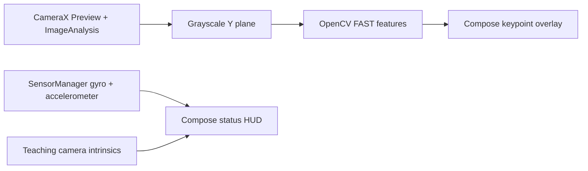

# Mobile SLAM

An Android teaching app for making monocular visual-SLAM pipeline stages visible to students. Milestone 1 displays a live CameraX preview with OpenCV FAST keypoints, available IMU samples, and explicit camera-intrinsics defaults.

## Assumptions

- The initial delivery is milestone 1; tracking, initialization, mapping, replay, and the remaining modes are staged work.
- Live use requires a rear camera and runtime camera permission. Missing accelerometer or gyroscope hardware does not prevent camera analysis.
- The displayed intrinsics are a teaching estimate for a nominal 640×480 image, not measured device calibration. CameraX may choose a nearby supported resolution.
- FAST points are detected independently in each frame; they are not yet tracked, matched, or classified as SLAM inliers.
- Camera and sensor timestamps are exposed in nanoseconds from their Android monotonic timestamp sources; cross-device calibration and synchronization are not claimed.

## Build and run

1. Install Android Studio, JDK 17, and Android SDK platform/build tools for API 35.
2. Open the project in Android Studio and allow Gradle sync, or run `./gradlew :app:assembleDebug`.
3. Install the debug APK on a physical Android 8.0+ device with a rear camera, or use an emulator with camera passthrough.
4. Grant camera permission when prompted. Available accelerometer and gyroscope samples appear in the HUD.

Run local JVM tests with `./gradlew :app:testDebugUnitTest`. The current milestone does not yet include SLAM algorithm tests.

## Architecture

The app uses one Android application module with `sensors` for camera/IMU acquisition, `frontend` for detector settings, `calib` for intrinsics, and Compose UI in the root activity. Camera analysis runs on a dedicated single-thread executor; immutable feature snapshots are delivered to the main thread for drawing.

## Usage in class

Move the camera over a textured scene and observe which image locations produce FAST corners. Compare the displayed point count as texture and motion change. The points are per-frame detections only, so they do not indicate camera motion or a solved pose yet.

## Known limitations

- Monocular reconstruction has arbitrary scale; no metric scale is estimated.
- Pure rotation provides insufficient translational parallax for two-view initialization.
- Low-texture scenes provide few stable features.
- Intrinsics are not calibrated and distortion is not corrected.
- Keypoint overlay alignment uses an approximate center-crop transform; device-specific preview transforms may differ.
- This milestone does not implement tracking, pose estimation, map points, keyframes, charts, recorder/replay, or relocalization.
