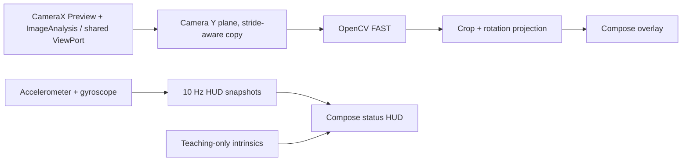

# Mobile SLAM

Android teaching app for making monocular visual-SLAM pipeline stages visible to students. The startup screen is a mode menu with a reserved logo slot; the **Tryb na żywo** route displays CameraX preview, OpenCV FAST detections, pyramidal Lucas–Kanade (KLT) correspondences, available IMU samples and teaching-only camera intrinsics.

## Assumptions

- This delivery is milestone 1; the menu shows tracking, initialization, map, calibration, recording/replay, metrics and optional ARCore as **disabled** future routes. The Settings screen edits and persists FAST and IMU HUD parameters (#22). A preliminary read-only hardware overview is available; complete diagnostics and export remain #23.
- Live use requires a rear camera and runtime camera permission. Missing accelerometer or gyroscope hardware does not prevent camera analysis.
- The displayed intrinsics are a teaching estimate for a nominal 640×480 image, not measured device calibration. CameraX can select another supported resolution.
- FAST detections seed KLT feature tracks; validated forward/backward optical flow carries stable IDs and track ages across frames. These are **2D image correspondences**, not triangulated map points, geometric inliers or camera pose.
- Camera and sensor timestamps are exposed in nanoseconds as reported by Android. Camera clock source and sensor time alignment must be validated per device before fusion.

## Build and run

1. Install Android Studio, JDK 17, Android SDK platform 35, and build tools 35.0.0.
2. Open the project in Android Studio, or run `./gradlew :app:assembleDebug`.
3. Install the debug APK on a physical Android 8.0+ device with a rear camera, or an emulator with a configured camera.
4. The **menu launches without camera permission**. Select **Tryb na żywo** and grant permission only then. The live screen shows FAST keypoints and available sensor values; use **Powrót do menu** or system Back to leave the camera.
5. **Ustawienia** edits FAST threshold (1–255, default 20) and IMU HUD update interval (100–1000 ms, default 100). Settings persist across restarts and apply on the next **Tryb na żywo** entry. **Przywróć domyślne** resets both fields. Future controls are disabled.
6. **Parametry sprzętowe i diagnostyka** shows a read-only, source-labelled hardware inventory: Android/build/API, CPU/RAM/storage/display/battery/thermal information, reported Camera2 properties (including timestamp source), sensor metadata and previously observed CameraX ImageAnalysis geometry and cadence. It does not request CAMERA permission or activate IMU on entry.
7. **Uruchom pomiar IMU** explicitly subscribes to available accelerometer/gyro events, independently from the 10 Hz teaching HUD. Stop the test to see observed callback counts, median Hz, jitter and gaps. The listener stops automatically on lifecycle stop/screen exit.
8. **Uruchom test kamery (tryb na żywo)** opens the existing camera preview and requests camera permission there only. After returning to the diagnostic screen, observed resolution, crop/rotation, Y strides, camera timestamps and processing time can be inspected. **Eksportuj JSON** writes a locally selected schema-v1 report with units, source labels, missing-data reasons and an untested hardware acceptance checklist. No images, recordings or unique device IDs are exported.
9. **O aplikacji** shows version/license, and **Zamknij aplikację** finishes the Activity.

Run local JVM tests with `./gradlew :app:testDebugUnitTest`.
Run Android lint with `./gradlew :app:lintDebug`.
Run Kotlin formatting checks with `./gradlew :app:ktlintCheck`.
Compile Compose Android UI tests (without an emulator) with `./gradlew :app:assembleDebugAndroidTest`. The instrumentation tests require a device/emulator to execute; compilation **does not** mean they have passed on hardware.
The `Android CI` workflow runs all four tasks on pull requests and pushes to `main` and `fix/**`. It uploads Gradle test/lint reports and a downloadable `mobile-slam-debug-apk` artifact. From a successful workflow run, download and extract the APK, then install with `adb install -r app-debug.apk` after enabling USB debugging on the test device.

## Architecture

The navigation shell uses a typed `AppDestination` registry and blocks destinations marked as unavailable. Preferences DataStore maintains a versioned, validated immutable Settings snapshot, read once into the app-level state. New values apply to freshly created FAST and IMU HUD objects when the Live screen is entered, never by mutating active OpenCV processing. The main menu does not acquire sensors. Live camera/IMU resources exist only while **Tryb na żywo** is composed; returning to the menu disposes them. No external navigation framework was introduced for this small first milestone.

Camera analysis runs on a dedicated single-thread executor and publishes immutable feature snapshots to the main thread. With the M2 frame contracts, a per-session ordering gate rejects invalid, duplicate and decreasing CameraX timestamps before processing, while a coalescing main-thread dispatcher keeps **at most one pending UI snapshot**. CameraX `KEEP_ONLY_LATEST` remains the bounded acquisition policy. Changes in ImageProxy dimensions, crop or rotation start a new geometry segment while frame IDs remain increasing. The analyzer is retired on its serial executor after camera unbind. The camera preview and image-analysis use cases share a CameraX `UseCaseGroup` / `ViewPort`; the overlay maps raw FAST coordinates through the image crop and rotation into `PreviewView` coordinates. A compatible TextureView ensures Compose draws above the camera image.

Camera use cases are bound to the lifecycle and unbound individually when the screen is disposed. IMU listeners start at `ON_START` and unregister at `ON_STOP`. The sensors run in Android's `SENSOR_DELAY_GAME` mode; HUD snapshots are throttled to approximately 10 Hz to avoid unnecessary recompositions. Accelerometer and gyroscope timestamps are retained separately. This HUD path is not a synchronized, full-rate visual-inertial sensor-fusion feed.

## Temporal FAST-to-KLT tracking (M2)

The analyzer owns the current grayscale Mat and a single retained previous grayscale clone. OpenCV `Video.calcOpticalFlowPyrLK` estimates correspondences in both directions; points are accepted only when both status flags succeed, coordinates are finite and in the ImageProxy crop, and the forward–backward residual is below the configured threshold. A spatially distributed, bounded pool replenishes verified tracks from FAST detections when fewer than the configured minimum remain.

The overlay uses **cyan** for freshly detected seeds and **green** for points tracked from the preceding frame, with short image-space displacement segments. It reports separate new/tracked/rejected counts. Stable track IDs and ages are reset on loss, image geometry/rotation/crop change or a timestamp gap longer than 250 ms (IDs are not reused within an analyzer session). KLT is not visual odometry or SLAM initialization. Monocular scale, calibration and camera–IMU temporal alignment remain unresolved.

KLT thresholds are validated in `frontend.Settings` with defaults: 240 maximum tracks; replenishment under 90; 21-pixel LK window; pyramid level 3; 1.5 px forward/backward error limit; 9 px minimum separation; 8×6 spatial cells. The KLT configuration is currently fixed in the UI; only previously supported FAST threshold and IMU HUD settings are persisted.

## Usage in class

Move the camera across a textured scene and observe the location and count of FAST corners. Compare low- and high-texture surfaces and different motion conditions. KLT trajectories show image-space motion only; neither track counts nor displacements constitute a solved camera pose.

## Tests

JVM tests cover:

- crop and rotation mapping at 0°, 90°, 180°, and 270°, including bounds and invalid dimensions;
- padded Y-plane rows and nonunit pixel strides;
- settings validation, supported schema and fallback behavior;
- bounded camera/IMU timestamp statistics, percentiles and clock domain gating (REALTIME vs UNKNOWN);
- the IMU HUD sampling gate and reset behavior.

For device acceptance:
1. Verify initial menu opens without permission dialog, navigation through Settings/About, disabled modes, Android Back and explicit Exit. From Live, return to menu repeatedly and inspect CameraX/IMU teardown.
2. Grant and revoke camera permission, confirming the preview can start and recover.
3. Rotate the device through 0°, 90°, 180°, and 270°; inspect FAST corner registration at more than one aspect ratio.
4. Move the application to the background and back; confirm IMU sampling stops and restarts, and that the camera preview recovers.
5. Test devices with both, one, or no inertial sensors when available; inspect sample availability and timestamps.
6. Leave the camera active for several minutes, watching for preview stalls, crashes, or excessive thermal load.

Record the device model, Android version, observed camera orientation and pass/fail for each test before marking Milestone 1 fully accepted.

A first Samsung SM-S938B / Android 17 **partial physical-device observation** is recorded in [docs/device-tests/sm-s938b-2026-11-05.md](docs/device-tests/sm-s938b-2026-11-05.md). The portrait recording shows a live preview, FAST markers and IMU HUD, but does **not** satisfy #4 (permission revoke/regrant, controlled rotation/overlay geometry, sensor lifecycle, validated camera/IMU clock domains, 5–10 minute stability and exported JSON). The exact tested APK commit SHA is still unknown.

The hardware diagnostics screen groups the inventory into expandable sections to reduce scrolling without dropping fields from the read-only report or JSON export. When returning to Live from Android settings/background, CAMERA permission is rechecked; a revoked grant stops the camera route and exposes the permission request action.

## Hardware diagnostics and timestamp integrity

The diagnostic screen distinguishes **reported** Camera2/SensorManager properties, **requested** CameraX settings, **observed** ImageAnalysis/IMU callback measurements and **unavailable/unmeasured** data. Android may withhold some Camera2 metadata before camera permission is granted; such fields are marked unavailable. Reported camera resolutions and AE FPS ranges do not prove the effective stream parameters: only actual ImageProxy buffers do.

Camera FPS is estimated from timestamp intervals of the processed analysis frames (not necessarily raw camera capture FPS). IMU callbacks in the explicit diagnostic test are not throttled to the teaching HUD cadence, although Android may cap their requested sampling rate. Timestamp source UNKNOWN **blocks cross-domain subtraction**. REALTIME indicates a potentially common clock but does not validate exposure/sample latency or synchronization. The application does not currently estimate a corrected camera–IMU offset.

The exported checklist remains NOT_TESTED until a physical-device acceptance report is produced for issue #4; an APK passing CI is not a hardware qualification.

## Known limitations

- Monocular scale remains arbitrary; no metric scale is estimated.
- Pure rotation lacks translational parallax for two-view initialization.
- Low-texture scenes produce few stable features.
- Camera intrinsics are not calibrated and distortion is not corrected.
- Sensor and camera timestamps are not synchronized or validated for visual-inertial fusion.
- KLT provides only local, image-space feature tracking; no visual odometry, pose estimation, map points, keyframes, charts, recorder/replay, or relocalization is implemented. Hardware inventory, basic camera/IMU measurements and JSON export are implemented; quantitative device acceptance still requires #4 and measured camera calibration remains #9.
- Overlay alignment and lifecycle behavior require physical-device validation; CI runs only host JVM tests and static checks.
