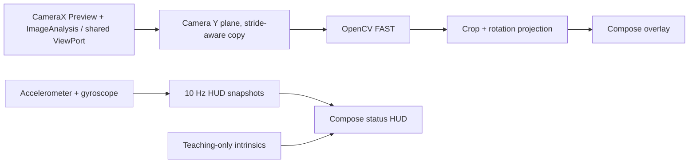

# Mobile SLAM

Android teaching app for making monocular visual-SLAM pipeline stages visible to students. Milestone 1 displays a live CameraX preview, OpenCV FAST keypoints, available IMU samples, and explicit camera-intrinsics defaults.

## Assumptions

- This delivery is milestone 1; tracking, initialization, mapping, replay, and the remaining modes are staged work.
- Live use requires a rear camera and runtime camera permission. Missing accelerometer or gyroscope hardware does not prevent camera analysis.
- The displayed intrinsics are a teaching estimate for a nominal 640×480 image, not measured device calibration. CameraX can select another supported resolution.
- FAST points are detected independently in every frame; they are not SLAM tracks, matches, or inliers.
- Camera and sensor timestamps are exposed in nanoseconds as reported by Android. Camera clock source and sensor time alignment must be validated per device before fusion.

## Build and run

1. Install Android Studio, JDK 17, Android SDK platform 35, and build tools 35.0.0.
2. Open the project in Android Studio, or run `./gradlew :app:assembleDebug`.
3. Install the debug APK on a physical Android 8.0+ device with a rear camera, or an emulator with a configured camera.
4. Grant camera permission. The screen shows FAST keypoints and the most recent sensor values when available.

Run local JVM tests with `./gradlew :app:testDebugUnitTest`.
Run Android lint with `./gradlew :app:lintDebug`.
Run Kotlin formatting checks with `./gradlew :app:ktlintCheck`.
The `Android CI` workflow runs all four tasks on pull requests and pushes to `main` and `fix/**`. It uploads Gradle test/lint reports. A successful CI run confirms compilation and host-side tests, not physical-device camera behavior.

## Architecture

Camera analysis runs on a dedicated single-thread executor and publishes immutable feature snapshots to the main thread. The camera preview and image-analysis use cases share a CameraX `UseCaseGroup` / `ViewPort`; the overlay maps raw FAST coordinates through the image crop and rotation into `PreviewView` coordinates. A compatible TextureView ensures Compose draws above the camera image.

Camera use cases are bound to the lifecycle and unbound individually when the screen is disposed. IMU listeners start at `ON_START` and unregister at `ON_STOP`. The sensors run in Android's `SENSOR_DELAY_GAME` mode; HUD snapshots are throttled to approximately 10 Hz to avoid unnecessary recompositions. Accelerometer and gyroscope timestamps are retained separately. This HUD path is not a synchronized, full-rate visual-inertial sensor-fusion feed.

## Usage in class

Move the camera across a textured scene and observe the location and count of FAST corners. Compare low- and high-texture surfaces and different motion conditions. The feature detections do not yet imply camera motion or a solved camera pose.

## Tests

JVM tests cover:

- crop and rotation mapping at 0°, 90°, 180°, and 270°, including bounds and invalid dimensions;
- padded Y-plane rows and nonunit pixel strides;
- the IMU HUD sampling gate and reset behavior.

For device acceptance, verify camera permission, background/foreground transitions, screen rotation, overlay registration for multiple resolutions/aspect ratios, sensor availability, and sustained operation without leaks or preview stalls.

## Known limitations

- Monocular scale remains arbitrary; no metric scale is estimated.
- Pure rotation lacks translational parallax for two-view initialization.
- Low-texture scenes produce few stable features.
- Camera intrinsics are not calibrated and distortion is not corrected.
- Sensor and camera timestamps are not synchronized or validated for visual-inertial fusion.
- No tracking, pose estimation, map points, keyframes, charts, recorder/replay, or relocalization is implemented.
- Overlay alignment and lifecycle behavior require physical-device validation; CI runs only host JVM tests and static checks.
